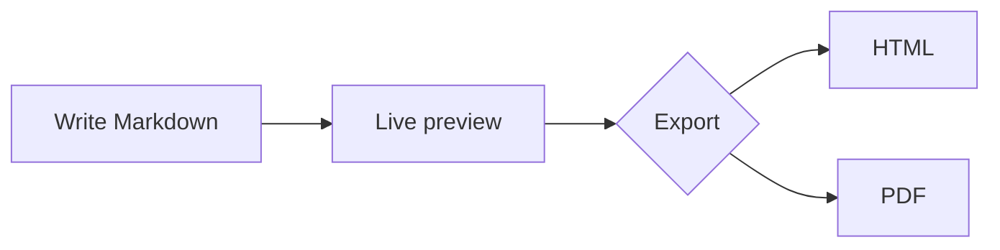

# Lightdown test drive

Every feature, with a checkbox to tick as you go. **Click a checkbox in the preview** to tick it. That's one of the tests too.

Open the outline with **⌥⌘O** to jump between sections.

Testing edits this file and adds images next to it. Afterwards, `git checkout Lightdown-Test.md` resets the file; pasted images are git-ignored.

## 1. Zoom

- [ ] ⌘= zooms in; the editor and the preview both grow
- [ ] ⌘- zooms out
- [ ] ⌘0 resets to actual size
- [ ] Pinch on the trackpad over either pane zooms too
- [ ] Quit and reopen: the zoom level is remembered

## 2. Appearance

- [ ] View → Appearance → Dark: the editor and preview share one dark background
- [ ] View → Appearance → Light
- [ ] View → Appearance → System follows macOS again
- [ ] The Mermaid diagram and code colours in section 10 switch with it

## 3. Outline sidebar

- [ ] ⌥⌘O shows the outline; it lists every heading, indented by level
- [ ] Clicking a heading jumps there, and the preview follows
- [ ] Scrolling highlights the current section in the outline
- [ ] Add a heading below (type `## New section` at the end of this list) and watch it appear
- [ ] ⌥⌘O hides it again; reopen the app and it remembers

## 4. Formatting shortcuts

Try each shortcut on the words below. Select a word, or just put the cursor inside it, then press the shortcut. Press it again to undo the formatting.

- [ ] ⌘B → make bold
- [ ] ⌘I → make italic
- [ ] ⌘B then ⌘I on the same word → both (`***word***`); each one comes off on its own
- [ ] ⇧⌘X → strike through
- [ ] ⌃` → make code
- [ ] ⌘K with "documentation" selected → `[documentation]()`, with the cursor between the brackets
- [ ] Copy `https://example.com`, select "this link", press ⌘K → it links straight to the copied URL
- [ ] Select `https://example.com` itself and press ⌘K → `[](https://example.com)`, ready for the text

Practice words: make bold · make italic · strike through · make code · documentation · this link

## 5. Lists

Put the cursor at the end of a line in each list and try:

- [ ] **Return** continues the list (bullets, numbers and to-dos)
- [ ] **Return** on an empty item: a nested one moves up a level, a top-level one ends the list
- [ ] **Tab** indents an item, taking its sub-items along; **⇧Tab** outdents
- [ ] Numbers renumber themselves after Return or Tab

Bullets:

- Apples
- Bananas
  - Ripe ones
  - Green ones
- Cherries

Numbered (press Return after "Two", then Tab on "Three"):

1. One
2. Two
3. Three
4. Four

Lazy numbering stays lazy (press Return after "Bravo"):

1. Alpha
1. Bravo
1. Charlie

## 6. To-dos

- [ ] Put the cursor on the line below and press **⌘L** three times: plain → `- [ ]` → `- [x]` → `- [ ]`
- [ ] Select all three practice lines and press ⌘L: they all switch together
- [ ] Press Return at the end of a to-do: a new empty to-do appears
- [ ] Click checkboxes in the **preview**; ⌘Z undoes a click
- [ ] Ticked items are dimmed in the editor

Practice lines:

Buy milk
Call the dentist
Water the plants

## 7. Moving list items

- [ ] Cursor on "Second": **⇧⌘↑** moves it above "First"; **⇧⌘↓** moves it back
- [ ] Moving "Parent" carries "Child A" and "Child B" with it
- [ ] "Child B" moves past "Child A" but never leaves "Parent"
- [ ] In the numbered list, moving keeps the numbers 1, 2, 3 in order
- [ ] In this paragraph (not a list), ⇧⌘↑ still selects to the top of the document

Practice list:

- First
- Second
- Parent
  - Child A
  - Child B
- Last

Practice numbered list:

1. Red
2. Green
3. Blue

## 8. Heading links

- [ ] [Jump to section 12](#12-scroll-sync) in the preview
- [ ] [Jump back to the top](#lightdown-test-drive)
- [ ] Duplicate headings get numbered IDs: [first "Notes"](#notes) and [second "Notes"](#notes-1)
- [ ] A footnote link works too[^1]

### Notes

The first "Notes" heading.

### Notes

The second "Notes" heading.

## 9. Images


- [ ] The image above shows in the preview (a relative path)
- [ ] Take a screenshot to the clipboard (⌃⇧⌘4), then paste here with ⌘V: it's saved in `images/` and linked
- [ ] Drag an image file from Finder into the editor: it's copied into `images/` and linked
- [ ] Copy rich text from Notes or Pages and paste it: you get text, not a picture

Paste or drop here:


## 10. Rendering

A Mermaid diagram:



A code block with syntax colouring:

```swift
struct Greeting {
    let name: String
    func message() -> String { "Hello, \(name)!" }
}
print(Greeting(name: "Lightdown").message())
```

| Feature        | Shortcut | Works? |
|----------------|:--------:|-------:|
| Bold           |    ⌘B    |      ✓ |
| Outline        |   ⌥⌘O    |      ✓ |
| Export PDF     |    —     |      ✓ |

> A blockquote, with ~~strikethrough~~, `inline code`, an autolink https://github.com and a [regular link](https://example.com).

---

- [ ] The diagram, code colours, table alignment and blockquote all look right
- [ ] Clicking an external link opens it in your browser

## 11. Word count

- [ ] The status bar under the editor shows the word count, e.g. "1,234 words"
- [ ] Select this paragraph: it changes to "N of 1,234 words"
- [ ] Typing updates it

## 12. Scroll sync

- [ ] Scroll the editor slowly through this section: the same content stays at the top of the preview
- [ ] Scroll the **preview** instead: the editor follows
- [ ] The long code block below lines up all the way through, not just at its start
- [ ] Scroll to the very bottom of either pane: the other reaches the bottom too
- [ ] No jitter or fighting between the panes when you stop

```text
line 01 · line 02 · line 03 · line 04 · line 05
line 06 · line 07 · line 08 · line 09 · line 10
line 11 · line 12 · line 13 · line 14 · line 15
line 16 · line 17 · line 18 · line 19 · line 20
line 21 · line 22 · line 23 · line 24 · line 25
line 26 · line 27 · line 28 · line 29 · line 30
line 31 · line 32 · line 33 · line 34 · line 35
line 36 · line 37 · line 38 · line 39 · line 40
line 41 · line 42 · line 43 · line 44 · line 45
line 46 · line 47 · line 48 · line 49 · line 50
```


Paragraph after the image. The image makes the preview much taller than the editor here, which used to throw off percentage-based sync.

## 13. Changes from other apps

With this file open and saved (it autosaves), run this in Terminal from the repo root:

```sh
echo "- [ ] Added from Terminal at $(date +%H:%M:%S)" >> Lightdown-Test.md
```

- [ ] The new line appears at the end of this file within a second or two
- [ ] Your cursor and scroll position don't jump
- [ ] Type something here (don't wait for it to save), then run the command again: Lightdown asks whether to reload or keep your version

## 14. Export, copy and print

- [ ] File → Export HTML… (⇧⌘E): the file opens in a browser with the same look, diagram included
- [ ] File → Export PDF…: normal size even when zoomed in, light even in dark mode, diagram included
- [ ] Select a few lines, Edit → Copy HTML (⌥⌘C): pasted into TextEdit it's HTML source; pasted into Mail it's formatted
- [ ] File → Print… (⌘P) previews the same clean layout

## 15. Window and panes

- [ ] ⌥⌘P hides and shows the preview
- [ ] ⌥⌘E hides and shows the editor
- [ ] ⌘F finds in the editor; ⌥⌘F finds and replaces
- [ ] ⌘Z / ⇧⌘Z undo and redo every kind of edit above

## 16. Reopening and recent files

- [ ] File → Open Recent lists the files you've opened, newest first; picking one opens it
- [ ] Two recent files with the same name show their folder to tell them apart
- [ ] Open two documents, quit with ⌘Q and reopen Lightdown: both come back
- [ ] Close every window, quit and reopen: you get one new blank document
- [ ] Reopening never adds an extra Untitled next to the documents that come back
- [ ] An empty Untitled document closes itself when you switch to another tab or open a file; one you've typed in stays

## Results

Anything that didn't work, or felt off:

- 

[^1]: This is the footnote. The ↩ link takes you back.
