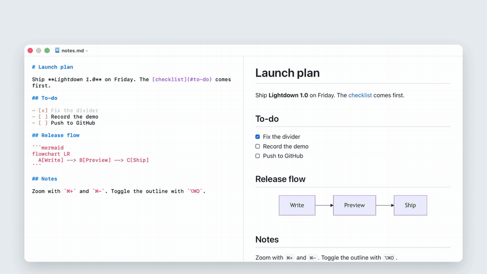
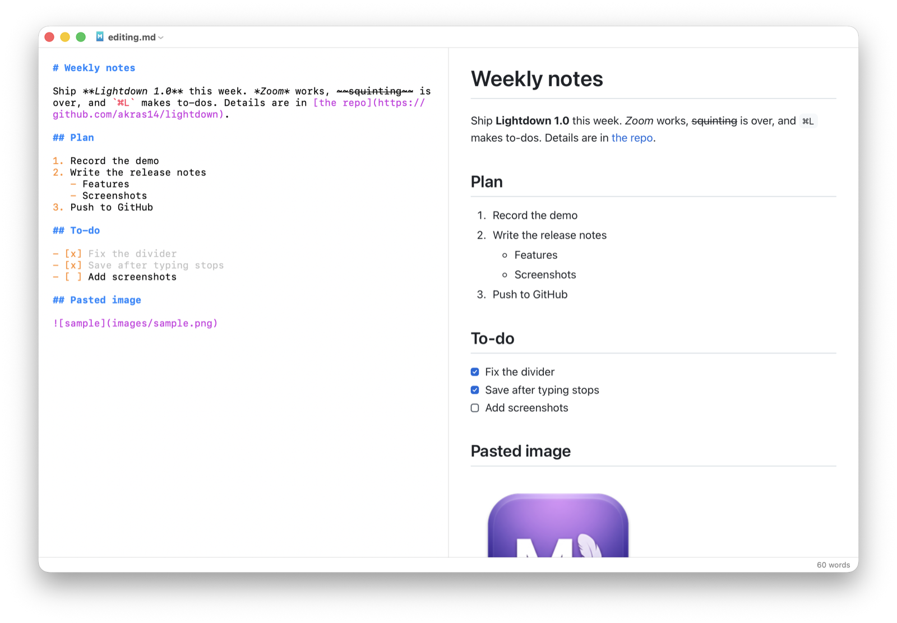
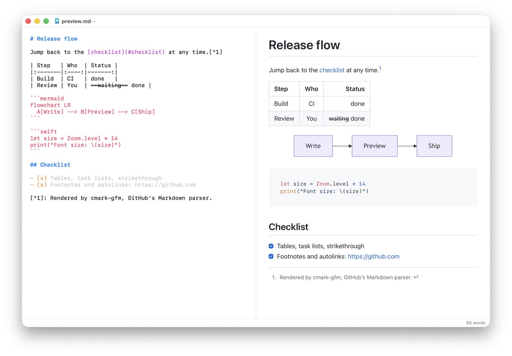
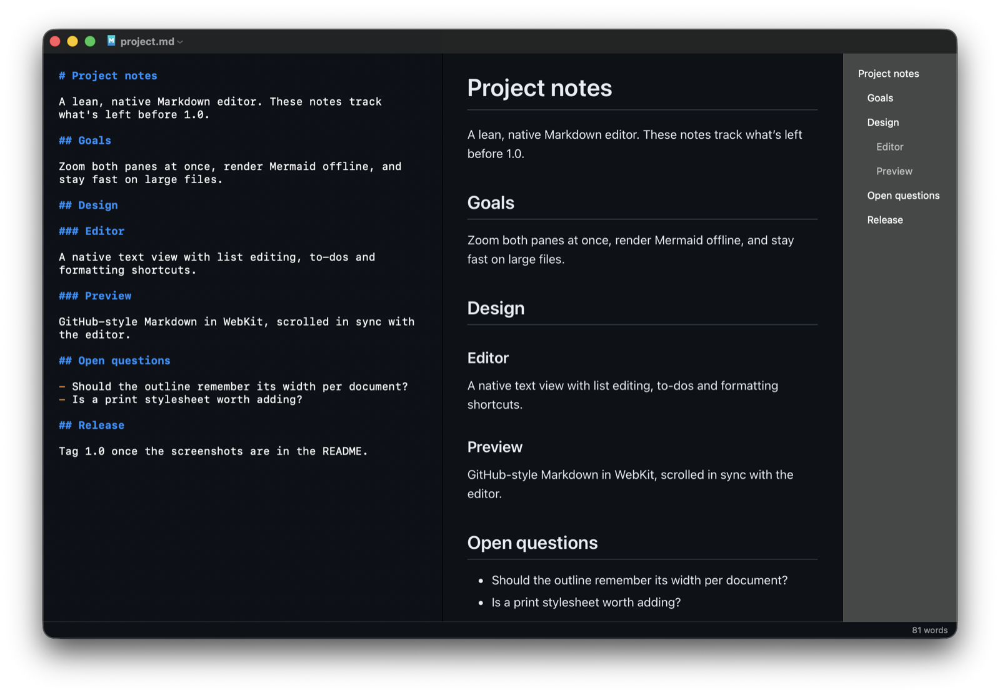
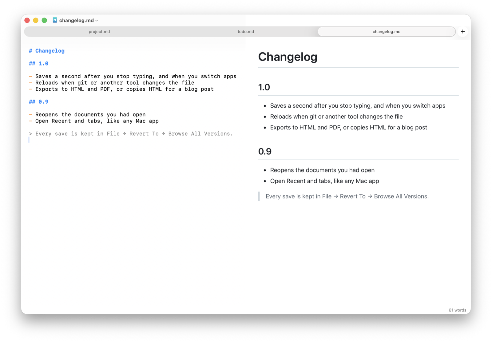

# Lightdown

A minimal, native Markdown editor for macOS: an editor on the left and a live preview on the right. It started as a lean replacement for MacDown 3000, mainly to add zoom in and out.



[Watch it as an MP4](media/demo-hyperframes.mp4).

**[Lightdown-Test.md](Lightdown-Test.md)** shows everything Lightdown supports as a hands-on checklist. Open it in Lightdown and try each feature on the practice text.

## Features

**Editing**



- **Zoom.** ⌘= / ⌘- / ⌘0, or pinch on the trackpad. One zoom level covers the editor and the preview, and it's remembered between launches.
- **Formatting shortcuts.** ⌘B bold, ⌘I italic, ⇧⌘X strikethrough, ⌃` inline code, ⌘K link. Each one toggles, and applies to the word at the cursor when nothing is selected. ⌘K uses a copied URL as the link target.
- **Lists.** Return continues bullet, numbered and to-do lists; Return on an empty item moves it up a level or ends the list. Tab / ⇧Tab indent and outdent items with their sub-items, and numbered lists renumber themselves.
- **To-dos.** ⌘L turns a line into a to-do (`- [ ] `), then checks and unchecks it, on one line or a whole selection. You can also click checkboxes in the preview.
- **Move list items.** ⇧⌘↑ / ⇧⌘↓ swap the current item, with its sub-items, past its neighbour. Numbered lists keep their order. In ordinary text these keys still select to the start or end of the document.
- **Images.** Paste a screenshot or drop image files into the editor. Images are saved or copied into an `images/` folder next to the document and linked.
- **Reloads on outside changes.** If git, another editor or an AI tool changes the file, Lightdown picks up the change and keeps your place. If you also have unsaved edits, it asks which version to keep.

**Preview**



- **GitHub-style Markdown** via [cmark-gfm](https://github.com/swiftlang/swift-cmark): tables, task lists, strikethrough, footnotes, autolinks.
- **Heading links.** Headings get GitHub-style IDs, so `[see setup](#setup)` jumps to them.
- **Mermaid diagrams** in fenced ` ```mermaid ` blocks, and syntax colouring for code.
- **Two-way scroll sync by source line.** Scrolling either pane keeps the same content at the top of the other, even past images and long code blocks.

**Window**



- **Outline sidebar** (⌥⌘O), on the right as in Obsidian. It lists the headings, jumps to one when you click it, and highlights the section you're in.
- **Word count** in a status bar along the bottom of the window, including for the selection.
- **Appearance:** View → Appearance → System, Light or Dark. The editor and preview share one colour scheme.
- **Hide either pane:** ⌥⌘E hides the editor, ⌥⌘P hides the preview. ⌥⌘0, or double-clicking the divider, splits them 50/50 again.

**Files**



- **Standard Mac documents:** autosave, version history, tabs, Open Recent, find and replace. The documents you had open come back when you reopen Lightdown.
- **Export** to HTML (⇧⌘E) or PDF, **Copy HTML** (⌥⌘C) for pasting into a blog or email, and **print**. PDFs and printouts are always at normal size and in light colours.
- **Works offline.** Everything is bundled and nothing loads from the network.

## Build

You need macOS 13 or later and the Xcode Command Line Tools (`xcode-select --install`). Full Xcode isn't required.

```sh
./build.sh            # builds build/Lightdown.app
./build.sh --install  # also copies it to /Applications
```

Run the tests with:

```sh
swift run LightdownChecks
```

They're a small executable instead of an XCTest target because XCTest and Swift Testing don't run with the Command Line Tools alone. They drive real text views and a real WebKit preview offscreen.

To see the app's final menus, including the items macOS adds itself, without opening any windows:

```sh
LIGHTDOWN_PRINT_MENUS=1 build/Lightdown.app/Contents/MacOS/Lightdown
```

To check preview styles, render a document's preview to a PNG:

```sh
swift run LightdownChecks --snapshot notes.md preview.png        # add "dark" for dark mode
```

To make Lightdown the default for `.md` files, open **Get Info** on any `.md` file in Finder, choose Lightdown under **Open with**, then click **Change All…**.

## Project layout

| Path | What it does |
|------|--------------|
| `Sources/LightdownKit/EditorSplitViewController.swift` | Editor and preview panes, scroll sync, zoom, pane toggles |
| `Sources/LightdownKit/MarkdownDocument.swift` | Opening, saving, HTML export, printing |
| `Sources/LightdownKit/MarkdownRenderer.swift` | Markdown to HTML via cmark-gfm |
| `Sources/LightdownKit/SyntaxHighlighter.swift` | Markdown colouring in the editor |
| `Sources/LightdownKit/Zoom.swift` | Zoom steps and the saved zoom level |
| `Sources/LightdownKit/App.swift` | App startup and menus |
| `Sources/LightdownKit/TodoList.swift`, `Lists.swift`, `ListMove.swift` | To-dos, list continuation and indenting, moving list items |
| `Sources/LightdownKit/Formatting.swift` | Bold, italic, link and other formatting shortcuts |
| `Sources/LightdownKit/EditorGeometry.swift` | Line positions in the editor, used by scroll sync |
| `Sources/LightdownKit/Outline.swift` | Heading parsing and the outline sidebar |
| `Sources/LightdownKit/PrintJob.swift` | Printing and PDF export |
| `Sources/LightdownKit/ImageInsertion.swift` | Pasting and dropping images |
| `Sources/LightdownKit/Theme.swift` | Appearance setting and shared colours |
| `Sources/Lightdown/main.swift` | Starts the app (the code lives in `LightdownKit`) |
| `Checks/` | Test suite |
| `Resources/preview.html`, `preview.css` | Preview page: rendering, scroll sync, checkbox clicks, styles |
| `Resources/headings.js` | Heading IDs, shared by the preview and HTML export |
| `scripts/make-icon.swift` | Builds `AppIcon.icns` from `icon-source.jpg` |

To change the icon, replace `icon-source.jpg` and run `swift scripts/make-icon.swift icon-source.jpg`.

## Third-party code

These libraries are bundled in `Resources/`:

- [highlight.js](https://highlightjs.org) 11.9.0: BSD 3-Clause
- [Mermaid](https://mermaid.js.org) 11.12.0: MIT

This one is fetched by Swift Package Manager when you build:

- [swift-cmark](https://github.com/swiftlang/swift-cmark), `gfm` branch: BSD 2-Clause

## License

Lightdown is licensed under the [Apache License 2.0](LICENSE). Third-party notices are in [NOTICE](NOTICE).
